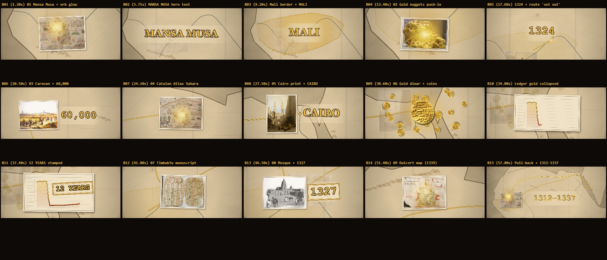
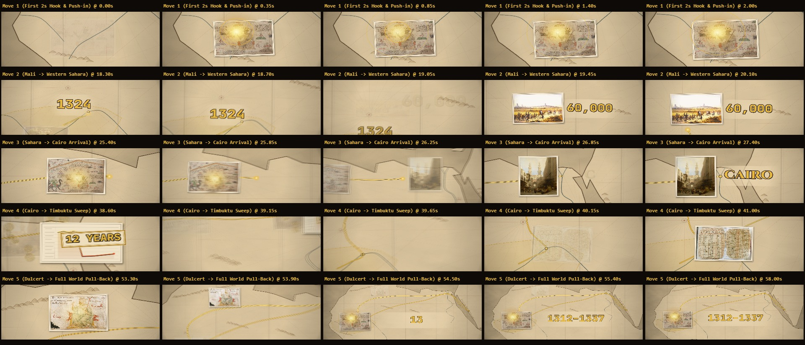

# Mansa Musa — The Golden Hajj (1324)

> **A 100% Code-Driven Cinematic Cartographic Documentary Built with HTML5 Canvas, HyperFrames, GSAP & FFmpeg.**
> No AI video generators. No stock footage. Every frame is procedurally drawn on an HTML5 `<canvas>` and rendered deterministically at `1920×824` (21:9 CinemaScope, `30 fps`, `H.264 yuv420p`, `CRF 16`).

[-d8a632?style=for-the-badge)](https://github.com/MaskedCM/mansa-musa-film/releases/download/v1.0.0/mansa_musa_final.mp4)
[](https://maskedcm.github.io/mansa-musa-film/)

---

## Visual Overview

### 15-Beat Storyboard Contact Sheet


### Continuous Single-Take Camera Path


---

## About the Film

**The Story:** In 1324, Mansa Musa — the fourteenth-century Emperor of Mali — crossed the Sahara toward Mecca with a caravan of 60,000 people and tons of pure West African gold, giving away so much treasure in Cairo that he crashed the regional value of gold for twelve years.

### Key Technical Highlights
- **Single Continuous Camera Flight**: One unbroken 78.60-second (`2,358` frames) camera trajectory over a `3800×2400` procedural 14th-century Portolan parchment map of West Africa, the Sahara, the Mediterranean, Egypt, and Arabia.
- **Deterministic Frame Architecture**:
  - Exposes both the **HyperFrames** master GSAP timeline (`window.__timelines["main"]`), custom `hf-seek` event listener, and `window.seek(t)`.
  - Zero `Math.random()` calls — all parchment grain, ink stippling, dust motes, and 2-Hz handheld camera weave use a seeded **Mulberry32** PRNG so every render is bit-accurate.
- **Archival Physical Prints**: Nine public-domain historical engravings, coins, manuscripts, and Catalan Atlas panels (`assets/01.jpg`–`09.jpg`) drop onto the parchment with multi-pass directional drop shadows, spring physics, and custom Canvas 2D shaders (golden orb radial bloom, animated Mamluk gold dinar scatter, and live Cairo gold-price crash ledger).
- **Broadcast Studio Audio (`-15.4 LUFS`)**:
  - Narrated with British documentary voiceover (`en-GB-RyanNeural`), synced word-for-word via [`timings.json`](./timings.json).
  - Layered with studio Foley & SFX (`whoosh`, `impact-bass`, `pop`, `typing`, `click-soft`, `riser`) offset `+33ms` (1 frame) after each visual hit, ducked ambient score, and normalized via FFmpeg `loudnorm=I=-15:TP=-1.5:LRA=11`.

---

## Project Structure

| File | Description |
|---|---|
| [`mansa_musa_final.mp4`](./mansa_musa_final.mp4) | Final rendered 21:9 film (`1920×824`, `30 fps`, `78.60s`, `H.264 High Profile`, `CRF 16`) |
| [`index.html`](./index.html) | HyperFrames root composition with `@font-face` declarations & re-brandable CSS variables |
| [`film.js`](./film.js) | Procedural Portolan map renderer, camera rig, Mulberry32 PRNG, and 15-beat choreography |
| [`SPEC.md`](./SPEC.md) | Numerical visual, typography, color, camera, and motion specification |
| [`STORYLINES.md`](./STORYLINES.md) | Narrative treatment and storyline architecture |
| [`REVIEW.md`](./REVIEW.md) | HyperFrames QA verification & broadcast audio measurement report |
| [`generate_voiceover.py`](./generate_voiceover.py) | Voiceover synthesis, studio SFX Foley placement, and EBU R128 `-15 LUFS` loudness normalization |
| [`render_video.js`](./render_video.js) | Headless frame-by-frame renderer (`window.seek(t)`) + FFmpeg H.264 muxer |

---

## Running & Rendering Locally

```bash
# Preview the interactive HyperFrames studio timeline
npx hyperframes preview

# Run static + headless browser + audio QA checks
npx hyperframes check
npx hyperframes audio mansa_musa_final.mp4

# Render deterministic MP4 via headless Chrome + FFmpeg
node render_video.js
```

